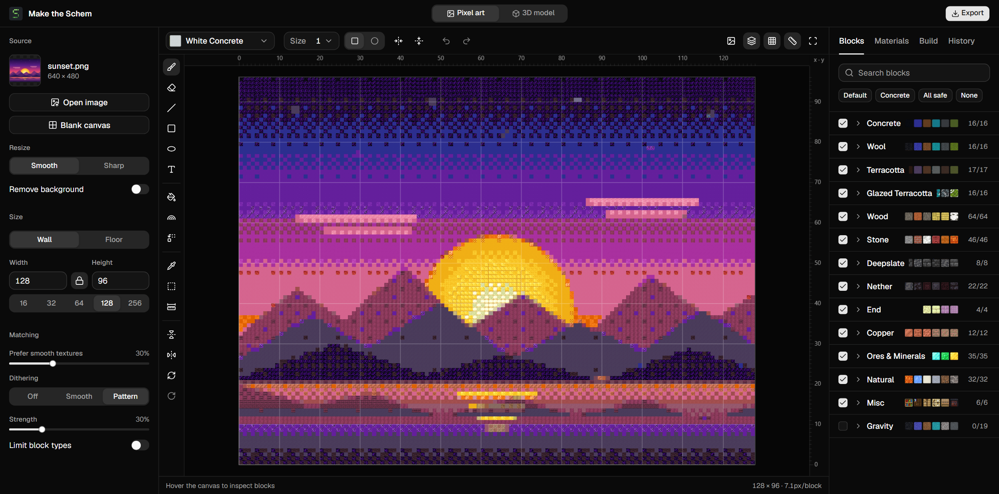
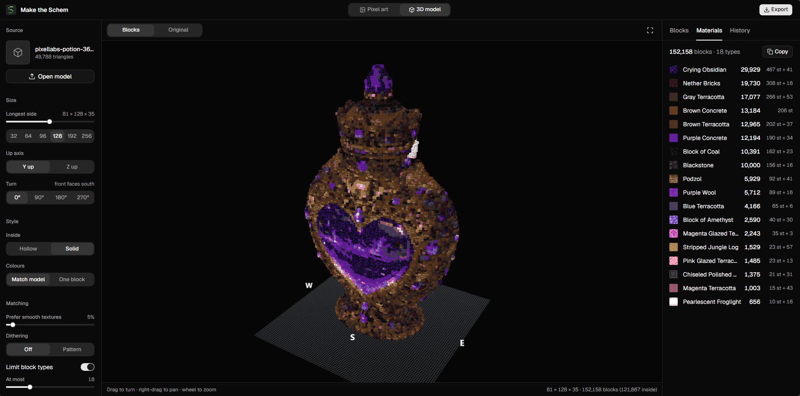
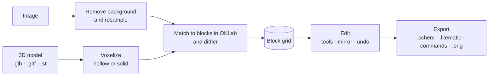

# Make the Schem

**Turn any image into Minecraft pixel art, and any 3D model into a build.** Edit it block by block, then export a `.schem`, a `.litematic` or plain `/fill` commands. Everything runs locally in your browser.

> **NOT AN OFFICIAL MINECRAFT PRODUCT. NOT APPROVED BY OR ASSOCIATED WITH MOJANG OR MICROSOFT.**

      [](LICENSE)

[Features](#features) · [Quick start](#quick-start) · [Pixel art](#pixel-art) · [3D models](#3d-models) · [Export](#export) · [How it works](#how-it-works) · [Development](#development) · [User guide](docs/GUIDE.md)



## Features

| | |
|---|---|
| 🖼️ **Image to pixel art**<br>Drop in a PNG, JPEG, GIF or WebP and get a one-layer build as a wall or a floor, up to 1024 blocks wide. Background removal turns the backdrop into air. | 🧊 **3D model to build**<br>Load a `.glb`, `.gltf` or `.stl` and get a full 3D build up to 256 blocks on its longest side, hollow or solid, coloured from the model's own textures. |
| 🎨 **Colour matching that looks right**<br>Blocks are matched in the perceptual OKLab colour space from their average texture colour, with a preference for smooth textures and two dithering styles. | ✏️ **A real editor**<br>Brush, line, rectangle, ellipse, text, fill, gradient, select and move, measure, mirror painting, rulers and 100 undo steps, with a Photoshop-style options bar. |
| 🧱 **Built for survival**<br>An interactive materials list with stack counts, one-click "avoid this block" swaps, and a Build mode that walks you through the art row by row and remembers your progress. | 📦 **Export anywhere**<br>`.schem` for WorldEdit and FAWE, `.litematic` for Litematica, a no-mod command data pack, command-block commands, and a `.png` to share. |

Also:

- **Private by design.** Nothing is uploaded. Every art you make is autosaved in your browser, with its original image, so you can come back and change the settings later.
- **Limit block types.** Let the app pick the N blocks that represent the image best, so there is less to collect in survival.
- **Keep editing.** Open an existing `.schem` and carry on where WorldEdit left off.
- **Wall faces.** Choose which side of a wall the picture is seen from, so you never need `//rotate`.
- **Save to world.** With the dev server, write a data pack straight into one of your Minecraft worlds.
- **Follows your system theme**, light or dark.

## Quick start

You need [Node.js](https://nodejs.org) 20.19 or newer (or 22.12+), and Minecraft Java Edition **26.3** installed through the official launcher and started once, so that `26.3.jar` exists.

```sh
git clone https://github.com/riqqu/maketheschem.git
cd maketheschem
npm install
npm run dev        # http://localhost:5173
```

> [!NOTE]
> The first `npm run dev` reads the block list, colours and textures from **your own** Minecraft jar and writes them to `src/data/blocks.json` and `public/atlas.png`. Both files are git-ignored. This repository contains no Mojang assets, which is also why there is no hosted demo.

**macOS, Linux and other Minecraft versions**

The extractor looks for the jar at `%APPDATA%\.minecraft\versions\26.3\26.3.jar`, which is the Windows default. On other systems, or for another version, point it at the jar yourself, then start the app:

```sh
# macOS
npm run extract -- "$HOME/Library/Application Support/minecraft/versions/26.3/26.3.jar"

# Linux
npm run extract -- "$HOME/.minecraft/versions/26.3/26.3.jar"

npm run dev
```

Add `--list` to print every block the extractor keeps. `MC_JAR=<path>` works too.

## Pixel art

From a picture to a build in six steps:

1. **Load.** Drop an image anywhere, start from a blank canvas, or open a `.schem`.
2. **Shape.** Wall or floor, size with aspect lock and presets, smooth or sharp resizing. *Remove background* detects the colour along the edges and turns it into air; *Outside only* keeps enclosed areas such as the letters inside a logo.
3. **Match.** Prefer smooth textures, dither with *Smooth* (error diffusion) or *Pattern* (ordered 8×8, easier to build by hand), and limit the number of block types. Choose which blocks may be used by category, by block or by search.
4. **Edit.** Fix and finish the art with the tools below.
5. **Plan.** The **Materials** tab is your shopping list. The **Build** tab turns the art into rows or 16 × 16 sections to tick off.
6. **Export.** Pick a format and follow the in-game steps shown in the dialog.

| Tool | Key | Highlights |
|---|---|---|
| Brush · Eraser | B · E | Size 1 to 100, square or round, [ ] to resize |
| Line · Rectangle · Ellipse | L · U · C | Shift snaps to 45°, a square or a circle. Outline or filled, thickness, corner radius, draw from the centre |
| Text | T | Built-in 5×7 pixel font with lowercase and accented Latin letters, adjustable scale |
| Fill · Replace all | G · R | Colour tolerance, optional diagonals |
| Gradient | D | Steps through the blocks between two colours, optionally dithered |
| Pick block | I | Also right-click or Alt+click with any tool |
| Select | S | Move, copy, cut, paste, flip and rotate |
| Measure | M | Span and distance between two blocks; rulers count blocks from the origin |

**Mirror painting** draws everything at its reflection too, left–right, top–bottom or both. Drag a mirror line in half-block steps to put it between two blocks or through the middle of one. Press `O` to lay the source image over your blocks, `F` to fit the art, and use the wheel and Space+drag to zoom and pan.

The full reference, with every option and shortcut, is in the **[user guide](docs/GUIDE.md)**.

## 3D models

Switch to **3D model** at the top, or drop a `.glb`, `.gltf` or `.stl` file anywhere.

 A 49,788-triangle potion bottle, built from 18 block types: 497,399 blocks at 121 × 192 × 53.

- **Size and orientation.** Longest side from 4 to 256 blocks, Y-up or Z-up (picked automatically for STL), quarter turns.
- **Hollow or solid.** A closed one-block shell uses far fewer blocks. Solid also fills the inside.
- **Match model.** Colours come from the model's textures, vertex colours and material colours. Top and bottom faces use the blocks' top textures, the sides use their side textures. *One block* builds everything from a single block, the default for STL.
- **The same matching as images.** Smooth textures, pattern dithering laid on each surface, and a limit on block types.
- **Interactive preview.** Orbit, pan and zoom, hover a block to see its name and position, and flip to *Original* to compare against the source model.

## Export

| Format | For | In game |
|---|---|---|
| .schem | WorldEdit, FAWE | Put it in plugins/WorldEdit/schematics/ (server) or config/worldedit/schematics/ (mod), then //schem load  and //paste -a |
| .litematic | Litematica | Put it in .minecraft/schematics/ and load it from the Litematica menu for a hologram and material list |
| Commands, data pack | Vanilla, no mods | Drop the zip in the world's datapacks folder, run /reload, then /function mts: |
| Commands, command block | Vanilla, no mods | Paste each part into one command block and press the button |
| .png | Sharing | An image of the art with the block textures |

The command export merges neighbouring blocks of the same kind into `/fill` boxes (at most 32,768 blocks each) and runs large builds in parts, one per tick. Positions can be relative to you or fixed coordinates, and the build can clear its area first. See [Commands](docs/GUIDE.md#commands-no-mods) for the details.

## How it works



- **Your Minecraft jar is the source of truth.** The extractor keeps only blocks that stay put and look the same from every visible side, then stores each block's average texture colour per face and how noisy the texture is. Floors are matched with the top face, walls with the side face.
- **Heavy work stays off the UI thread.** Generation and model building run in Web Workers, and the 3D mode loads on first use.
- **No file-format libraries.** The NBT, Sponge v3 `.schem`, `.litematic`, gzip and zip writers are written from scratch in [`src/core`](src/core). The tests read the NBT, `.schem` and `.litematic` output back with an independent NBT parser.
- **Pure core.** Everything that matters, from matching and dithering to shapes, mirroring and command generation, is plain TypeScript with no DOM or React, covered by Vitest.

## Tech stack

| | |
|---|---|
| UI | React 19, [shadcn/ui](https://ui.shadcn.com) on Radix, Tailwind CSS v4, lucide-react, sonner |
| 3D | [three.js](https://threejs.org) for the model preview and loading |
| Language and build | TypeScript, Vite |
| Concurrency and storage | Web Workers, IndexedDB for history, localStorage for settings |
| Tests | Vitest |

## Project structure

```
src/
├── core/         Pure logic: matching, dithering, grids, shapes, NBT, .schem, .litematic, commands
├── lib/          Browser glue: IndexedDB, image and model loading, rendering
├── worker/       Web workers for generation and model building
├── app/          The application: pixel art editor, 3D workspace, panels and hooks
├── components/   Small UI primitives on top of shadcn/ui
└── styles.css    Tailwind import and every design token
scripts/          The block extractor and the dev server's Minecraft saves API
docs/             User guide
```

## Development

```sh
npm run dev          # dev server with hot reload, http://localhost:5173
npm test             # Vitest: the core logic
npm run typecheck    # tsc --noEmit
npm run build        # typecheck + production build
npm run preview      # serve the production build
```

[`CLAUDE.md`](CLAUDE.md) explains where code goes and the UI conventions (shared primitives, design tokens, keyboard shortcuts, tool options). Please run `npm test`, `npm run typecheck` and `npm run build` before sending changes.

**Good to know**

- Opening a `.schem` works for one-block-thick builds (a wall or a floor) in the Sponge format written by WorldEdit 7+ and this app. Blocks that are not in the usable list become air, and you are told how many.
- 3D models must be self-contained: export a `.gltf` with separate `.bin` or image files as a single `.glb`. Draco-compressed meshes and KTX2 textures cannot be read; meshopt compression works.
- 3D builds are not kept in the History and cannot be edited block by block yet.
- Sand, gravel and concrete powder sit under **Gravity** and are off by default, because they fall.
- The history keeps the 40 most recent arts in the browser's storage. Clearing site data deletes it.

## License

Make the Schem is released under the [MIT License](LICENSE). It covers the original source code, documentation and logo in this repository. It does not cover Minecraft's name, brand or assets, the screenshots (they show Minecraft textures), or the third-party software listed below.

## Credits and disclaimer

**NOT AN OFFICIAL MINECRAFT PRODUCT. NOT APPROVED BY OR ASSOCIATED WITH MOJANG OR MICROSOFT.**

Make the Schem is a free, fan-made tool. Minecraft is a trademark of Mojang Synergies AB, and all rights in the Minecraft name, brand and assets belong to Mojang and Microsoft. They did not make, review or endorse this project. I (riqqu) publish and own Make the Schem and am responsible for it, not Mojang or Microsoft. Contact: [github.com/riqqu](https://github.com/riqqu). See Mojang's [Minecraft Usage Guidelines](https://www.minecraft.net/en-us/usage-guidelines).

- **No Minecraft content is included.** Block names, colours and textures belong to Mojang. The app reads them from your own copy of the game on your computer, and the extracted files are git-ignored. Do not host or share a build of the app that contains them. The screenshots show the game's textures as drawn by the app, only to show what the tool does; the textures stay Mojang's and Microsoft's. The name and logo are my own, and the app uses no Minecraft logo, font or other brand elements.
- **The libraries are not my work.** Make the Schem is built on open-source software by many other people, including [React](https://react.dev), [three.js](https://threejs.org), [Radix UI](https://radix-ui.com/primitives), [shadcn/ui](https://ui.shadcn.com), [Tailwind CSS](https://tailwindcss.com), [Vite](https://vite.dev) and [Lucide](https://lucide.dev). I do not claim any of it, and each keeps its own license. The full list is in [THIRD_PARTY_NOTICES.md](THIRD_PARTY_NOTICES.md).
- **Ideas and formats.** The [OKLab](https://bottosson.github.io/posts/oklab/) colour space by Björn Ottosson, the [Sponge Schematic Specification](https://github.com/SpongePowered/Schematic-Specification), the [Litematica](https://github.com/maruohon/litematica) format, and the "one command" technique from the [Minecraft Wiki](https://minecraft.wiki).
- **Screenshots.** The 2D screenshot uses artwork made for this project. The 3D screenshot shows a model from [Pixabay](https://pixabay.com), used under the [Pixabay Content License](https://pixabay.com/service/license-summary/); the model file is not in this repository.